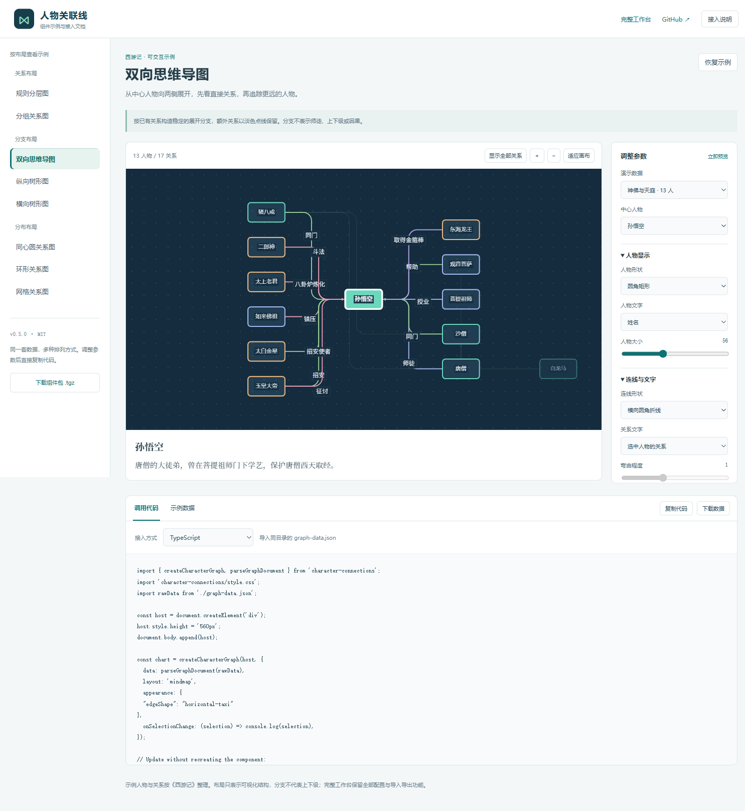

# 人物关联线 · Character Connections

可自定义的人物关系图组件与演示工作台。使用 TypeScript、Cytoscape.js、Vite，MIT 开源。

以《西游记》展示从单个人物到复杂关系网的展开过程。默认布局由规则控制，不使用随机位置；核心人物居中，相关人物按指定层级与左右顺序排列。



## 本地运行

需要 Node.js 22.18+，推荐 Node.js 24。

```bash
git clone https://github.com/cdNingJing/character-connections.git
cd character-connections
npm ci
npm run dev
```

访问 <http://127.0.0.1:4180>。

```bash
npm test
npm run build
npm run preview
```

预览和开发服务使用同一端口，不能同时启动。构建结果在 `dist/`；`dist/standalone.html` 内嵌全部脚本与样式，可作为单文件演示。

## 演示过程

1. **单个人物**：孙悟空居中，1 人物。
2. **取经团队**：加入唐僧、猪八戒、沙僧、白龙马，5 人物。
3. **神佛与天庭**：上方加入师承、神佛和天庭人物，13 人物。
4. **完整示例**：加入妖怪、家属与多重关系，26 人物、43 关系。

点击“下一阶段”逐步展开，或直接选择阶段。已有节点保留位置；视图以孙悟空为中心缩放。演示阶段表示图谱复杂度，不代表章节或所有关系同时发生。

## 布局规则

- `coreId` 指定核心人物，规则坐标为 `(0, 0)`。
- `placement.level` 控制上下层：负数在上、0 同层、正数在下。
- `placement.order` 控制左右顺序：负数在左、正数在右。
- 重复槽位按固定 id 顺序分开，不依赖数组顺序或随机数。
- 未提供核心时，按关系数量及 id 确定核心。
- 导入的 `position` 与手动调整可保留；重新排列时恢复规则。

默认使用独立曲线控制点，平行及反向关系分开绘制，优先选择绕开其他人物节点的曲率。复杂图仍可能有交叉，不承诺任意图都能无交叉。详见 [规则布局与路由](docs/layout-rules.md)。

## 定制能力

- 背景颜色、本地图片、点阵和网格。
- 连线曲线、直线、圆角折线，以及实线、虚线、点线。
- 连线粗细、颜色、文字、方向箭头。
- 平滑高亮、淡入淡出、无动画，遵循减少动态效果设置。
- 人物搜索、选择高亮、拖动、缩放和关系说明。
- JSON 导入导出，保留外观、层级约束与人物坐标。
- 手机设置面板与浏览器本地保存。
- 通用组件保留章节范围过滤；《西游记》演示未编造章节数据，隐藏章节控件。

## 数据格式

```json
{
  "schemaVersion": 1,
  "title": "人物关系示例",
  "maxChapter": 1,
  "coreId": "wukong",
  "characters": [
    {
      "id": "wukong",
      "name": "孙悟空",
      "group": "取经团队",
      "placement": { "level": 0, "order": 0 }
    },
    {
      "id": "tangseng",
      "name": "唐僧",
      "group": "取经团队",
      "placement": { "level": 0, "order": -1 }
    }
  ],
  "relations": [
    {
      "id": "master",
      "source": "tangseng",
      "target": "wukong",
      "label": "师徒",
      "type": "mentorship",
      "directed": true
    }
  ]
}
```

所有阶段的完整 JSON 见 `examples/journey-stage-1.json` 至 `journey-stage-4.json`。使用 `npm run examples` 重新生成。

协议见 [schema.json](schema.json) 和 [数据格式](docs/data-format.md)。

## 接入自己的项目

当前提供可安装的 `.tgz` 包，尚未发布到 npm registry。`npm run build` 同时生成示例站、类型声明、库和 `dist/character-connections-0.7.0.tgz`。

```bash
npm install ./character-connections-0.7.0.tgz
```

```typescript
import { createCharacterGraph, parseGraphDocument } from 'character-connections';
import 'character-connections/style.css';
import rawData from './graph-data.json';

const chart = createCharacterGraph(document.querySelector<HTMLElement>('#graph')!, {
  data: parseGraphDocument(rawData),
  layout: 'mindmap',
  appearance: { edgeShape: 'horizontal-taxi' },
  onSelectionChange: (selection) => console.log(selection),
});
chart.update({ appearance: { nodeShape: 'ellipse' } });
// 页面卸载时调用 chart.destroy()。
```

容器必须有明确高度，例如 `height: 560px`。首页按 8 种布局分类，实时同步参数与调用代码；可切换 TypeScript、HTML 自定义元素、React、Vue 3，编辑或下载配套数据。原工作台在 `/workbench.html`。

也可以使用 `character-connections/element` 导出的 `registerCharacterConnections()`，注册 `<character-connections>` 标准自定义元素。它的 `data`、`options` 是 JS 属性，`layout` 同时支持属性和 HTML attribute，选中时派发 `selection-change` 事件。导入不会自动注册元素，SSR 环境中应在浏览器挂载后创建组件。

完整说明见 [组件 API](docs/component-api.md)。

## 开发与范围

```bash
npm run format
npm test
npm run build
```

数据输入保护上限为 500 人物和 3000 条关系，不是性能保证。默认演示以可解释的位置规则和关系呈现为主，没有在线多人编辑、后端存储和全局无交叉布局。人物描述也不会自动执行防剧透检查。

人物和关系说明根据原著自行归纳，布局是本项目的可视化编排，见 [演示数据说明](docs/journey-data.md)。

参考了 [relation-graph](https://github.com/relation-graph/relation-graph)、[G6](https://github.com/antvis/G6) 等开源项目，实际依赖为 [Cytoscape.js](https://github.com/cytoscape/cytoscape.js)。详见 [项目参考](docs/references.md) 和 [第三方声明](THIRD_PARTY_NOTICES.md)。

贡献方式见 [CONTRIBUTING.md](CONTRIBUTING.md)。许可证：[MIT](LICENSE)。

## 可选 GitHub Actions

自动检查模板位于 [docs/ci-workflow.yml](docs/ci-workflow.yml)。将其放到 .github/workflows/ci.yml 后可运行 npm ci、npm test 和 npm run build；当前仓库尚未启用该工作流。

### v0.3 工作区

增加双向思维导图、横向树、纵向树、同心圆和网格布局。左侧调整设置，中间查看图谱，右侧查看人物资料。西游记 26 人示例包含别名及身份、地点、兵器、经历等自定义资料。人物形状、大小、画布文字和详情字段均可设置，JSON 可导入导出。

### v0.4 连线与文字

8 种连线路径，支持调节曲线弯曲程度和折线圆角。关系文字可设置字号、换行宽度、底色、方向、位置及偏移，自动尽量错开人物和其他文字；支持只显示选中的一条关系。旧 JSON 继续兼容，全部新设置可导入导出。

### v0.5 可复用组件与示例站

首页按布局分类展示 8 种示例。每个示例可以切换数据和中心人物、调整样式、编辑 JSON、下载数据，并复制 TypeScript、HTML 自定义元素、React 或 Vue 3 的调用代码。复制内容仅包含相对默认值有变化的外观参数。

组件提供 `createCharacterGraph` 和 `<character-connections>` 两种接入方式；构建生成独立 ESM、CSS、类型声明及可安装的 `.tgz` 包。`npm run dev` 会先生成组件包，确保示例页下载链接可用。

### v0.6 独立分组背景

新增随画布移动和缩放的分组背景区，支持每组名称、颜色、说明与全局透明度、间距、边框配置。分组示例采用浅色卡片网格，分组名独立显示；选择人物不改变背景或其他人物的位置。背景元数据随 JSON 导入导出，也同步出现在组件调用代码中。

### v0.7 跨组通道与局部展开

分组示例默认只显示组内关系。点击人物展开他的跨组关系，其他人物和分组保持原位；取消选中即可收起。跨组连线采用组边出口和组间通道，“显示全部关系”开关可查看完整图谱。参数同步到组件调用代码与 JSON。
